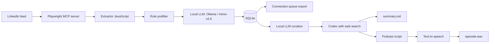

# Research Radar

Keeping up with AI-for-materials research takes time, and a LinkedIn feed mixes research with posts that do not report scientific results. Research Radar gives a computational materials scientist a daily researched briefing and a list of researchers to connect with by hand, with the goal of making the feed more relevant.

## What it does

- Scans the LinkedIn feed and classifies posts against a field profile.
- Exports a queue of authors to consider connecting with. The owner sends each request by hand.
- Curates saved posts into a daily Codex-researched digest and a two-host podcast audio file.

## Architecture



MCP is the Model Context Protocol, which connects the Python orchestrator to the browser server. The local large language model (LLM) classifies posts and selects digest items.

| Component | File | Role |
|---|---|---|
| Browser | `src/radar/browser/mcp_client.py` | Starts Playwright MCP and restricts tool calls |
| Extractor | `src/radar/browser/extract_feed.js` | Reads visible feed cards |
| Scanner | `src/radar/scanner.py` | Scrolls, deduplicates and processes posts |
| Classification | `src/radar/classify.py` | Filters and classifies posts |
| Storage and queue | `src/radar/db.py`, `src/radar/queue.py` | Stores records and exports authors |
| Digest | `src/radar/digest.py`, `prompts/codex_digest.md` | Curates items and requests Codex research |
| Audio | `src/radar/podcast.py` | Converts the script to speech |
| Command line | `src/radar/cli.py` | Runs the pipeline and reports status |

## Design decisions

The scanner uses deterministic scrolling and extraction through Playwright MCP. The local model judges relevance and curates the digest; it does not direct the browser.

The browser client allows only navigation, evaluation, waiting, snapshots and closing. Tests reject click and form tools. The implemented scanner does not click Connect, like, comment or message. The allowlist alone is not a complete enforcement boundary, because `browser_evaluate` runs JavaScript. The scripts passed to it are fixed in the source code, not written by a model. The only page interaction they perform is expanding "… more" on post text.

The default scan stops after 60 posts, 10 minutes or six scroll steps without new cards. It pauses between steps. [LinkedIn User Agreement section 8.2](https://www.linkedin.com/legal/user-agreement) prohibits automated access and scraping. This tool keeps volume low and reads only the owner’s feed. The owner accepts the account risk.

Ollama runs the high-volume post classification locally. Codex performs the daily research on the curated selection.

The repository ignores `data/`, which contains feed records and the browser profile. Tests use synthetic fixtures. Selected post text and author information are included in the task sent to Codex for research.

## Requirements

- Windows 11
- Python 3.12 or later and `uv`
- Node.js, for `npx`
- Ollama with `mimo-v2.6` (6.6 GB; fits a 16 GB GPU)
- Codex CLI, logged in
- Playwright Chromium

## Setup

Run these commands from the repository root in PowerShell.

```powershell
uv venv -p 3.12 .venv
```

```powershell
uv pip install -p .venv -e ".[dev]"
```

```powershell
npx -y playwright@1.65.0-alpha-2026-10-30 install chromium
```

```powershell
ollama pull mimo-v2.6
```

```powershell
Copy-Item config/config.example.toml config/config.toml
```

```powershell
.\.venv\Scripts\Activate.ps1
```

```powershell
radar login
```

Log in to LinkedIn in the browser window. Start Ollama before running a scan or demo.

## Usage

```powershell
radar demo
```

The demo classifies synthetic posts and writes a queue under `data/demo/`. It uses Ollama and replaces any existing `data/demo/` directory.

```powershell
radar scan
```

Scan the feed, classify new posts and refresh the queue.

```powershell
radar reclassify
```

Re-judge every stored post with the current field profile, for example after editing `config/field_profile.md`. Posts that become relevant get their links resolved.

```powershell
radar queue
```

Export the current connection queue.

```powershell
radar queue mark <profile_url> sent
```

Replace `<profile_url>` with the author’s URL after sending a request. `skip`, `todo` and `connected` are also supported statuses.

```powershell
radar digest
```

Curate undigested saved posts, run Codex research and produce the written digest and audio. Saved posts that curation does not pick stay eligible for three days (`backlog_days`), then age out. A second run on the same day writes to a new folder, such as `2026-11-19-2`.

```powershell
radar podcast
```

Rebuild `episode.wav` for the latest digest from its saved Codex result, for example after a text-to-speech failure. Pass a folder name to pick another digest.

```powershell
radar daily
```

Run a scan followed by a digest.

```powershell
radar status
```

Show database counts, queue size and the latest digest.

To schedule the daily cycle for 08:30:

```powershell
powershell -ExecutionPolicy Bypass -File scripts/install_schedule.ps1 -Time 08:30
```

The task runs when the user is logged in and starts after a missed run when available. Remove the default task with:

```powershell
Unregister-ScheduledTask -TaskName ResearchRadarDaily -Confirm:$false
```

## Example output

The files in `docs/example/` come from `radar demo` followed by `radar digest` on the synthetic fixture posts. Their links point to `example.org`, so Codex could not find primary sources and reports that plainly with low confidence. The 6.3-minute audio file is not committed.

- [Digest summary](docs/example/digest-summary.md)
- [Podcast script](docs/example/podcast-script.md)
- [Connection queue](docs/example/connect-queue.md)

## Outputs

Default paths are relative to the repository root:

- `data/radar.db`: SQLite database of posts, authors and digests.
- `data/queue/connect_queue.md` and `connect_queue.csv`: connection queue.
- `data/digests/YYYY-MM-DD/summary.md`: researched briefing.
- `data/digests/YYYY-MM-DD/podcast_script.md`: two-host script.
- `data/digests/YYYY-MM-DD/episode.wav`: synthesized audio, when audio generation succeeds.
- `data/digests/YYYY-MM-DD/codex_task.md` and `codex_result.json`: research prompt and structured result.
- `data/logs/`: scheduled daily-run logs.

## Podcast audio

The default `sapi` backend uses installed Windows voices and needs no model download. If only one voice is installed, both hosts use it.

For the optional Kokoro backend, install the extra:

```powershell
uv pip install -p .venv -e ".[kokoro]"
```

Download `kokoro-v1.0.onnx` and `voices-v1.0.bin` from the [kokoro-onnx GitHub releases](https://github.com/thewh1teagle/kokoro-onnx/releases) and place them in `data/models/`. Set `backend = "kokoro"` in the `[podcast]` section of `config/config.toml`.

## Customizing the field

Edit `config/field_profile.md` to define core topics, adjacent topics and material to skip. The classifier and digest curation use this profile. Run `radar reclassify` afterward to apply the change to stored posts.

Concrete examples in the profile help the 9B model more than abstract categories. On the first live scan, adding one example line moved an agentic-coding preprint from skip to adjacent, and a biology rule stopped a protein-model press release from being marked core. Classification runs at temperature 0, so the same post gets the same verdict. Setting `think = true` under `[llm]` makes the model reason first; in tests this was about three times slower and not more accurate overall.

## Tests

```powershell
.\.venv\Scripts\python -m pytest
```

Tests cover classification, scanning, deduplication, link handling, queue exports, browser tool restrictions, digest generation and podcast script cleanup using synthetic data and fakes.

## Limitations

- LinkedIn changes its page structure. Feed selectors live in `src/radar/browser/extract_feed.js`.
- The 9B local model misjudges some posts.
- Codex research quality depends on finding and interpreting the primary source.
- Automated feed access carries the LinkedIn User Agreement risk described above.

## License

MIT.