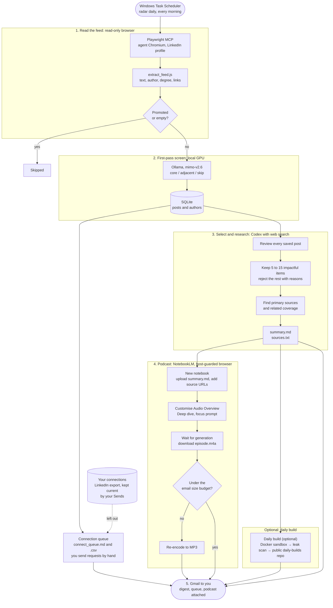
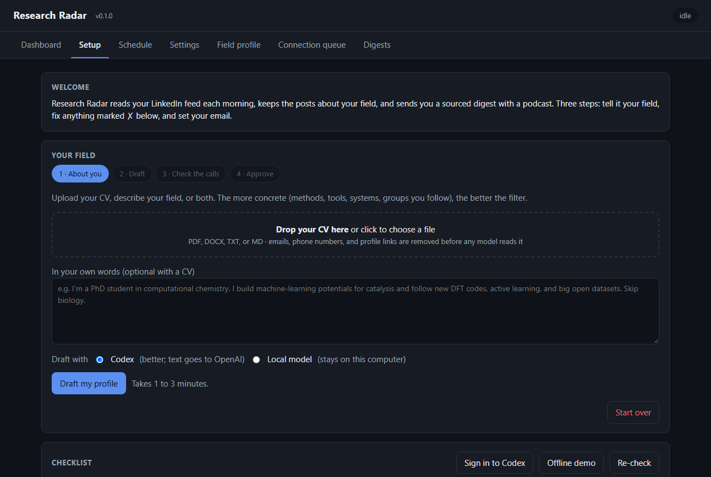
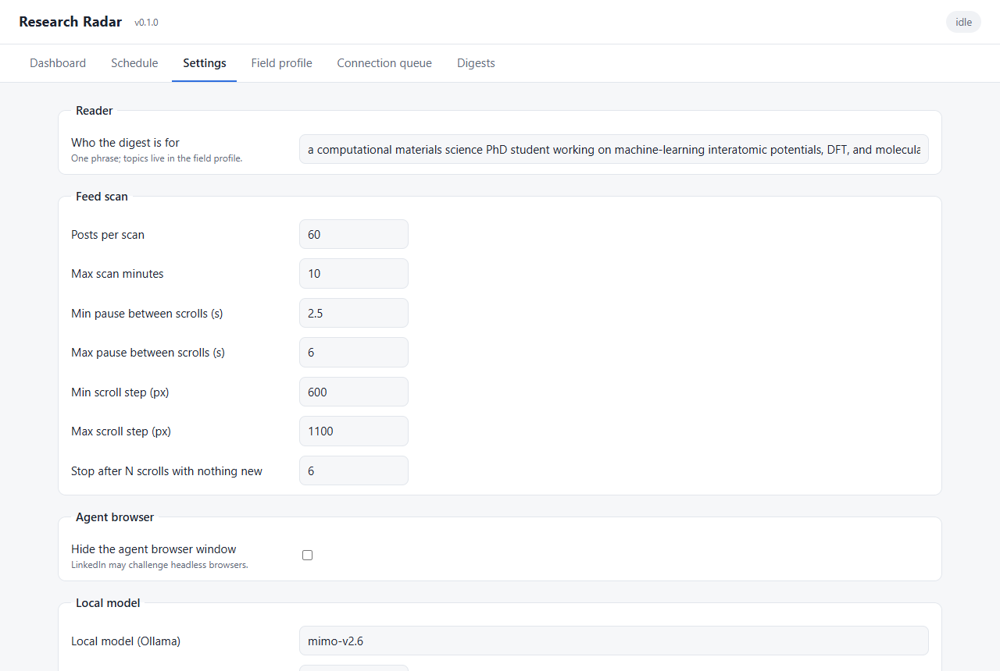
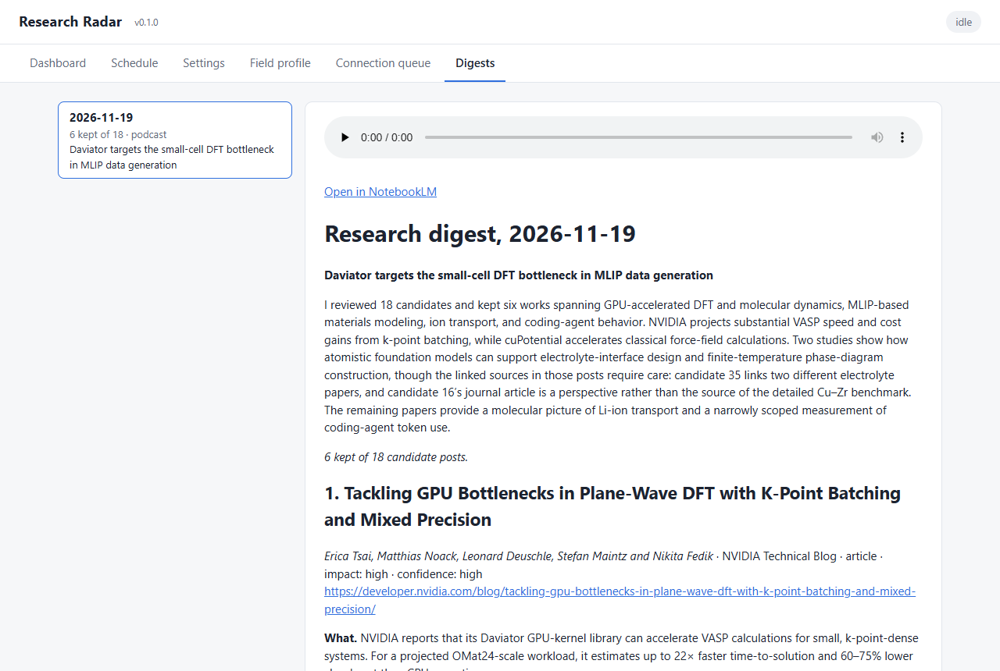

# Research Radar

[](https://github.com/AbrarFaiyad/research-radar/actions/workflows/ci.yml)


Keeping up with new research takes time, and a LinkedIn feed mixes real results with announcements, ads, and personal news. Research Radar reads the feed for you each morning, keeps the work that matters to your field, finds the primary sources, and delivers a written digest and a two-host podcast to your inbox. It also lists the researchers behind that work, so you can connect with them and make your feed better over time.

Everything runs from a local control panel. A setup wizard reads your CV, drafts a profile of your field, tests it on real posts from your feed, and refines it from your corrections, so the tool works for any field. The repository's own profile is set up for computational materials science.

Jump to: [Architecture](#architecture) · [Control panel](#control-panel) · [Installation](#installation) · [Command line](#command-line-reference) · [Engineering](#engineering)


## What it does

- Scans the LinkedIn feed and classifies posts against a field profile.
- Lists the authors worth connecting with, leaving out people you are already connected to or have invited. You send each request yourself.
- Sends every saved post to Codex, which keeps the 5 to 15 items with real impact, finds their primary sources and related coverage, and writes the digest.
- Turns the digest into a NotebookLM Audio Overview, a two-host podcast.
- Emails the digest, queue, and podcast to the owner each day.
- Optionally builds one small demo per day of the top open-source item in a Docker sandbox and publishes it to a public repo. It is off by default.
- Sets itself up from the control panel: a wizard builds your field profile from a CV, and every missing prerequisite has a fix button.
- Lets you run any step, change settings and the schedule, and work through the queue and past digests, all from the panel.
- Checks its own setup and records every daily run, stage by stage.

## Architecture

One daily run, top to bottom:



MCP is the Model Context Protocol, which connects the Python orchestrator to the browser server. The local large language model (LLM) is a permissive first-pass screen. Codex makes the final selection.

| Component | File | Role |
|---|---|---|
| Browser | `src/radar/browser/mcp_client.py` | Starts Playwright MCP and restricts tool calls |
| Extractor | `src/radar/browser/extract_feed.js` | Reads visible feed cards |
| Scanner | `src/radar/scanner.py` | Scrolls, deduplicates and processes posts |
| Classification | `src/radar/classify.py` | Filters and classifies posts |
| Storage and queue | `src/radar/db.py`, `src/radar/queue.py` | Stores records and exports authors |
| Connections | `src/radar/connections.py` | Reads LinkedIn's data export so connections stay out of the queue |
| Digest | `src/radar/digest.py`, `prompts/codex_digest.md` | Sends candidates to Codex and renders its result |
| Podcast | `src/radar/notebooklm.py` | Builds a notebook and downloads the Audio Overview |
| Daily builds | `src/radar/builds/` | `select` picks the item, `sandbox` runs Claude in Docker, `run` coordinates the build and the clean-install check, `scan` checks every file for leaks, `publish` pushes to the public repo, `keys` stores the API key |
| Build image | `docker/` | Builds the sandbox image and the allowlist proxy |
| Email | `src/radar/mailer.py` | Sends the daily email through Gmail SMTP |
| Pipeline | `src/radar/pipeline.py` | Runs stages in isolation, holds the run lock, writes run records |
| Health checks | `src/radar/doctor.py` | Checks every prerequisite and prints the fix for each gap |
| Settings | `src/radar/settings.py` | Typed, validated schema over `config/config.toml` |
| Onboarding | `src/radar/onboard.py` | CV reading and redaction, profile draft, calibration, refinement |
| Control panel | `src/radar/ui/` | FastAPI app and single-page interface behind `radar ui` |
| Command line | `src/radar/cli.py` | Engine behind every panel button and the scheduled task |

## Design decisions

The scanner uses deterministic scrolling and extraction through Playwright MCP. The local model judges relevance; it does not direct the browser.

The browser client allows only navigation, evaluation, waiting, snapshots and closing. Tests reject click and form tools. The implemented scanner does not click Connect, like, comment or message. The allowlist alone is not a complete enforcement boundary, because `browser_evaluate` runs JavaScript. The scripts passed to it are fixed in the source code, not written by a model. The only page interaction they perform is expanding "… more" on post text.

The default scan stops after 60 posts, 10 minutes or six scroll steps without new cards. It pauses between steps. [LinkedIn User Agreement section 8.2](https://www.linkedin.com/legal/user-agreement) prohibits automated access and scraping. This tool keeps volume low and reads only the owner’s feed. The owner accepts the account risk.

Ollama runs the high-volume first-pass screen locally, and it leans toward keeping borderline posts. Codex reviews every saved post each day, rejects weak ones with a stated reason, and keeps 5 to 15. If fewer posts meet the bar, Codex keeps fewer instead of padding the list.

NotebookLM has no consumer API, so the agent drives it in a second browser profile. That client may click and type, but only behind a host guard: every interactive call first checks that the page is on `notebook.google.com` or `notebooklm.google.com` and refuses otherwise. A file upload is allowed only straight after a host-checked click. Automating NotebookLM is outside Google's intended use, the same kind of risk as the LinkedIn scan.

The repository ignores `data/`, which contains feed records and the browser profile. Tests use synthetic fixtures. Selected post text and author information are included in the task sent to Codex for research.

## Control panel

Open it with the **Research Radar** shortcut on the desktop or in the Start menu. It is a local web page at `http://127.0.0.1:8765` that only your own computer can reach. Opening the shortcut again while the panel runs just brings the page back.

| Tab | What you can do |
|---|---|
| Dashboard | See saved posts, queue size, the last digest, the next scheduled run, and the run history with each stage's result. Start a full run or any single step, watch its log live, and cancel it. Check setup health and launch the LinkedIn and NotebookLM logins. |
| Setup | Build your field profile with the wizard (below). Work through a checklist of prerequisites, each with a button that fixes it: create the config, download the local model, install the agent browser and Codex, sign in to Codex, LinkedIn, and NotebookLM. Import your LinkedIn connections. Store the Gmail App Password and send a test email. |
| Schedule | Change the daily run time or switch it off. |
| Settings | Edit every setting in a validated form: scan limits and pacing, local model, Codex selection limits, podcast length, email. Bad values are rejected with a message and the file is left untouched. Comments in `config/config.toml` are kept. |
| Field profile | Edit what counts as relevant, then re-judge stored posts in one click. |
| Connection queue | **Send** opens the person's profile in your own browser; you click Connect there, then confirm in the panel ("Yes, sent" or "Already connected"). **Skip** drops them, and **Undo** brings them back. The agent never acts on LinkedIn. Download the list as CSV. |
| Digests | Read past digests, play their podcasts, open their NotebookLM notebooks, remake a podcast, or email a digest again. |

### Setup wizard

1. **About you.** Drop in a CV (PDF, DOCX, TXT, or MD), describe your field in a few sentences, or both. Email addresses, phone numbers, and profile links are removed before any model reads the text. You choose who drafts: Codex, which writes better profiles but sends the text to OpenAI, or the local model, which keeps it on your computer.
2. **Draft.** The model writes a field profile, listing named methods, tools, datasets, and groups under Core, Adjacent, and Skip, plus a one-line description of the reader. Edit both freely.
3. **Check the calls.** The draft is tested on 40 recent posts, read from your feed with the read-only browser or taken from posts already stored. Each post shows what the filter would do and why. Flip the calls that are wrong. Nothing is saved to the database.
4. **Approve.** The model rewrites the profile so the filter agrees with your corrections and lists what it changed. Apply it, and optionally re-judge stored posts. The old profile is backed up first.

The wizard's state is saved, so closing the tab loses nothing. The panel opens on the Setup tab the first time it runs.



<p>


</p>

The panel has no login, so it defends itself in three ways. The server binds to the loopback address only. Every request must name a loopback host, which stops DNS-rebinding pages. Every change must carry a token that is created at launch and embedded in the page, which stops other websites from posting to it. Digest text comes from Codex reading arbitrary web pages, so the panel escapes any HTML in it before display.

LinkedIn and Google passwords are typed only into the agent's own browser window. The Gmail App Password is typed into the panel and goes straight to Windows Credential Manager; the panel never shows it again, logs it, or writes it to a file.

Every button runs a `radar` command as a separate process. The panel, the scheduled task, and the tests therefore share one code path, and a job keeps running even if the browser tab closes.

## Installation

### Requirements

- Windows 11
- An NVIDIA GPU with at least 8 GB of video memory (VRAM) recommended for the local model. A CPU also works, but is slower.
- About 15 GB of free disk space
- A LinkedIn account
- A Google account for NotebookLM and Gmail
- An OpenAI account for the Codex command-line interface (CLI)

### 1. Install the system tools

Open PowerShell and install Git, Python, uv, Node.js, and Ollama. These are the only programs the control panel cannot install for you.

```powershell
winget install --id Git.Git -e
```

```powershell
winget install --id Python.Python.3.12 -e
```

```powershell
winget install --id astral-sh.uv -e
```

```powershell
winget install --id OpenJS.NodeJS.LTS -e
```

```powershell
winget install --id Ollama.Ollama -e
```

### 2. Get the code and install it

Open a new PowerShell window so Windows can find the new tools, then clone the repository:

```powershell
git clone https://github.com/AbrarFaiyad/research-radar.git
```

```powershell
cd research-radar
```

Run the installer. It creates the Python environment, installs the app, creates `config/config.toml`, adds a **Research Radar** shortcut to the desktop and the Start menu, and opens the control panel.

```powershell
powershell -ExecutionPolicy Bypass -File scripts\install.ps1
```

That is the last command you need.

### 3. Finish in the control panel

The panel opens on the Setup tab.

1. **Your field.** Run the [setup wizard](#setup-wizard). Drop in your CV, review the draft, test it on real posts, and approve it.
2. **Checklist.** Press the button next to each item marked ✗. Usually that means downloading the local model (about 6.6 GB), installing the agent browser and Codex, and signing in to Codex, LinkedIn, and NotebookLM. Sign-ins open a browser window where you type your own password; the agent never sees it.
3. **Daily email.** Enter your Gmail address and a [Gmail App Password](https://myaccount.google.com/apppasswords), which requires 2-Step Verification. Turn the daily email on and press **Send a test email**.
4. **Connections.** Request your data from LinkedIn ([Get a copy of your data](https://www.linkedin.com/mypreferences/d/download-my-data), pick Connections and Invitations) and drop the archive under Your connections. The queue then leaves out everyone you are connected to or have already invited. Each Send or "Already connected" in the queue keeps that list current.
5. **Schedule.** On the Schedule tab, pick a time and save.

To try a full run straight away, press **Full daily run** on the Dashboard and watch the log.

### Troubleshooting

- **"LinkedIn feed not visible (not logged in?)"**: press **Sign in** next to LinkedIn login in the Setup checklist.
- **"No SMTP password stored"**: enter the App Password under Daily email on the Setup tab.
- **"Ollama model ... not reachable"**: start the Ollama app, then press **Download model** in the checklist.
- **The podcast failed after a NotebookLM page change**: the email still goes out. Open the digest on the Digests tab and press **Make podcast**. The page selectors are in `src/radar/notebooklm.py`.
- **The shortcut window closed and the panel stopped**: the minimized window is the panel's server. Open the shortcut again.
- **Git reports "detected dubious ownership" in a cloud-synced folder**: run `git config --global --add safe.directory <path>`, replacing `<path>` with the repository's full path.

## Command-line reference

You never need the command line after installing; every command here is a button in the panel. The commands exist because the panel and the scheduled task run them, and because they are handy for scripting and remote use. Run them as `.\.venv\Scripts\radar.exe <command>`, or as `radar <command>` with the environment activated.

| Command | What it does | Panel button |
|---|---|---|
| `radar ui` | Open the control panel | Desktop shortcut |
| `radar onboard draft` / `calibrate` / `refine` | Wizard steps: draft the profile, test it on posts, refine it from corrections | Setup, wizard |
| `radar setup config` / `model` / `chromium` / `codex` / `codex-login` | Create the config, pull the local model, install the agent browser or Codex, sign in to Codex | Setup, checklist |
| `radar login`, `radar notebooklm-login` | Sign in to LinkedIn or Google in the agent browser | Setup, checklist |
| `radar email-setup` | Store the Gmail App Password (hidden prompt) | Setup, Daily email |
| `radar connections import <file>` | Load LinkedIn's data export (ZIP or Connections.csv) so connections never enter the queue | Setup, Your connections |
| `radar doctor` | Check every prerequisite and print the fix for each gap | Setup, checklist |
| `radar scan [--max-posts N]` | Scan the feed, classify new posts, refresh the queue | Dashboard, Scan feed |
| `radar reclassify` | Re-judge stored posts with the current profile; newly relevant posts get their links resolved | Field profile, Save and re-judge |
| `radar digest [--no-audio]` | Codex selects, sources, and summarizes the strongest 5 to 15 undigested posts, then NotebookLM makes the podcast | Dashboard, Digest |
| `radar podcast [folder]` | Make the podcast again for a digest | Digests, Make podcast |
| `radar email [folder] [--test]` | Email a digest, or a short test message | Digests and Setup |
| `radar daily` | Scan, digest, and email as isolated stages, with a run record | Dashboard, Full daily run |
| `radar build [folder] [--retry] [--prepare]` | Build and publish the day's demo from a digest. `--retry` runs a day that already has a record again. `--prepare` builds the Docker image and proxy and does not run a build | Daily builds, Retry; Setup, Build image |
| `radar builds-key` | Store the Anthropic API key for builds (hidden prompt) | Setup, Daily builds key |
| `radar queue [mark <url> sent]` | Export the connection queue or mark a person | Connection queue |
| `radar status` | Database counts, queue size, latest digest, last run | Dashboard |
| `radar demo` | Classify synthetic posts into `data/demo/` with the local model | Setup, Offline demo |

Codex reviews every candidate once, and saved posts older than three days (`backlog_days`) are dropped. A second digest on the same day goes to a new folder, such as `2026-11-19-2`. The daily task is `ResearchRadarDaily` in Task Scheduler; it runs while you are logged in, starts after a missed run, and logs to `data\logs\`.

## Engineering

- **Stage isolation.** `radar daily` runs scan, digest, and email as separate stages. A failed stage is recorded with its error, and the later stages still run, so a logged-out LinkedIn session still lets the backlog digest and the email go out. The command exits with code 1 when any stage fails, which Task Scheduler records.
- **Run records.** Each daily run writes `data/runs/<timestamp>.json` with every stage's outcome, duration, counts, and error. The dashboard and `radar status` read them.
- **One run at a time.** A lock file in `data/` stops the scheduled task, the panel, and the command line from running jobs at once. A lock is created atomically; one whose process has exited, or older than six hours, counts as stale.
- **Read-only by construction.** The LinkedIn browser client cannot reach any click or type tool. The NotebookLM client can, but only while the page is on NotebookLM's own hosts. Tests cover both.
- **Validated settings.** Settings have a typed schema with ranges and cross-field rules, such as minimum items not exceeding maximum items. Saves are atomic and keep the file's comments.
- **Build isolation.** Builds run in a Docker container on an internal network with an allowlist proxy. A second container runs the tests, and the host only copies plain files out. A leak scan blocks the push if it finds keys, personal details, local paths, or oversized files. Tests plant fake personal data and check that none of it reaches the container or the repo.
- **Privacy.** `data/` and `config/config.toml` are gitignored. Tests use synthetic posts. A CV is stripped of email addresses, phone numbers, and profile links before any model reads it, only the redacted text is kept, and the wizard lets you keep it on your computer by drafting with the local model. The LinkedIn export is read in memory; only names, profile links, and dates are stored. Health checks mask email addresses and home-folder paths.
- **Quality gates.** GitHub Actions runs Ruff lint, a format check, and the full test suite on Ubuntu and Windows for every push and pull request. Pre-commit runs the same checks locally.

## Example output

The files in `docs/example/` come from an early version that ran on the synthetic fixture posts. Their links point to `example.org`, so Codex could not find primary sources and reported that plainly with low confidence.

- [Digest summary](docs/example/digest-summary.md)
- [Connection queue](docs/example/connect-queue.md)

## Outputs

Default paths are relative to the repository root:

- `data/radar.db`: SQLite database of posts, authors, connections, and digests.
- `data/onboarding/`: setup wizard state, the redacted CV text, and backups of replaced field profiles.
- `data/queue/connect_queue.md` and `connect_queue.csv`: connection queue.
- `data/digests/YYYY-MM-DD/summary.md`: researched briefing.
- `data/digests/YYYY-MM-DD/sources.txt`: primary and supporting URLs given to NotebookLM.
- `data/digests/YYYY-MM-DD/notebook_url.txt`: link to the day's NotebookLM notebook.
- `data/digests/YYYY-MM-DD/episode.m4a`: the NotebookLM Audio Overview, when generation succeeds.
- `data/digests/YYYY-MM-DD/codex_task.md` and `codex_result.json`: research prompt and structured result.
- `data/runs/<timestamp>.json`: stage-by-stage record of each daily run.
- `data/logs/`: scheduled daily-run logs.

## Podcast

The podcast is a NotebookLM Audio Overview in the Deep dive format. For each digest the agent:

1. creates a new notebook;
2. uploads `summary.md` and adds Codex's source URLs as website sources (paywalled pages fail individually and are skipped);
3. opens "Customise Audio Overview", picks Deep dive and the configured length, and writes focus instructions from Codex's `podcast_focus`;
4. waits for generation, usually 5 to 15 minutes, and downloads the `.m4a` file.

The notebook stays in your NotebookLM account, so you can also listen or ask questions there. Set `length` under `[notebooklm]` to `shorter`, `default`, or `longer`. NotebookLM's interface changes over time; the selectors live in `src/radar/notebooklm.py`.

## Daily email

`radar daily` ends by emailing the day's digest to you when `[email] enabled = true`. The message body holds the digest and the connection queue. The attachments are the podcast (`episode.m4a`), `summary.md`, and `connect_queue.csv`, and the body links to the day's NotebookLM notebook. Gmail limits a message to 25 MB, and a default-length episode is about 17 MB. A file that would push the message past the limit is listed with its local path instead of attached; the notebook link still works.

Email goes out through Gmail SMTP with an App Password. An App Password is a 16-character password that Google issues for one app; it requires 2-Step Verification on the account.

1. Create one at <https://myaccount.google.com/apppasswords>.
2. On the Setup tab, under Daily email, enter your Gmail address and the App Password, and turn the daily email on. The password goes to Windows Credential Manager and never touches the repository or config files. If a different Gmail account sends, set "Send from" on the Settings tab.
3. Press **Send a test email**.

To revoke access, delete the App Password in your Google account.

## Daily builds

Reading about a package is not the same as using it. Once a day, Research Radar picks one open-source item from the digest. Claude Sonnet then builds a very small, complete demo with it. The demo is a learning kit that shows what the package is for and how to go from a blank folder to a result.

Builds are published to one public GitHub repo. The feature is off by default.

### What a build contains

Each build is one folder named `YYYY-MM-DD_<package>_<task>`, in lowercase with hyphens, for example `2026-11-21_mace-torch_lora-finetune-molten-salt`. The folder holds:

- `README.md`: the learning kit.
- `demo.py`: the commented demo.
- `requirements.txt`: pinned versions.
- `test_demo.py`: a smoke test that checks the demo runs and produces its output.
- `output/`: small results, such as a PNG plot or a table.
- `BUILD_LOG.md`: what Claude tried, what failed, and how it was fixed.

The README has fixed sections. They are a notice that the build is AI-generated and educational, what the package is and which problem it solves, the core ideas, where it fits against tools you know, install, a step-by-step walkthrough, the actual output, gotchas, limitations, how to adapt it, and the source paper, package link, and license.

The top-level README of the public repo lists every build with its date, package, and license. It also says whether the demo ran.

### When it runs

By default, the build starts as soon as Codex finishes the digest. It runs alongside the podcast, and the daily email reports the result. A failed or skipped build never fails the daily run.

In Settings you can instead run builds on their own schedule, at a time you choose. That build uses the latest finished digest of the day and skips if there is none.

The build takes the highest-ranked digest item that has a code link, an OSI-approved license, and a demo that runs on a CPU in about 10 minutes. It skips packages it has already built. If no item qualifies, the day is recorded as skipped.

### Safety model

No personal information may leave your computer through a build. The rules are:

- Nothing personal enters the sandbox. Claude receives only the selected item's public fields, the field profile that is already public in this repository, and the build instructions. The database, queue, connections, CV, settings, email details, and browser profiles stay out.
- The sandbox starts with an empty environment. It has no host environment variables, git settings, SSH keys, or GitHub token. The only host folder it can write to is an empty output folder for that build.
- The sandbox reaches only an allowlist of sites, such as PyPI, GitHub, Hugging Face, and the Anthropic API. Traffic goes through a proxy, and everything else is refused, including your local network. A malicious package therefore cannot probe your network or send data to an arbitrary server.
- A second, fresh container installs the requirements and runs the smoke test. Your computer never runs code from a build.
- Before any push, every file is scanned for API keys, your email addresses, local paths such as `C:\Users\<name>`, and files over the size limit (5 MB per file, 20 MB per build). If anything is found, the push is blocked and the build stays local. The panel shows the reason.
- Images are stripped of metadata. Only PNG and SVG outputs are allowed.
- Commits use your GitHub noreply identity and UTC time, so they carry no personal name, email, or time zone.
- A build whose demo did not run is still published. Its README and the index label it "did not run".

The build uses a dedicated Anthropic API key. Unlike everything else, this key does live inside the sandbox, so a malicious package could read it. Create the key in the Anthropic Console with a low monthly spend limit, and use it for nothing else.

### Set up daily builds

1. Install WSL2. Run `wsl --install` in an administrator PowerShell, then restart the computer.
2. Install [Docker Desktop](https://www.docker.com/products/docker-desktop/).
3. Create a public GitHub repo, for example `daily-builds`.
4. On the Setup tab, store the Anthropic API key. It goes to Windows Credential Manager, and the panel never shows it again.
5. On the Settings tab, enable Daily builds. Enter the repo, your git name, and your GitHub noreply email (`<id>+<username>@users.noreply.github.com`).
6. On the Setup tab, press **Build image** in the checklist. This builds the sandbox image and the proxy once.

The Daily builds tab then lists every build with its status, README, output, log, and a Retry button.

## Customizing the field

The [setup wizard](#setup-wizard) writes `config/field_profile.md` (core topics, adjacent topics, and what to skip) and the `reader` line under `[profile]` in `config/config.toml`. You can rerun the wizard any time, or edit the profile directly on the Field profile tab and re-judge stored posts in one click. The local screen and Codex both use this profile.

Concrete examples in the profile help the 9B model more than abstract categories. On the first live scan, adding one example line moved an agentic-coding preprint from skip to adjacent, and a biology rule stopped a protein-model press release from being marked core. The wizard's calibration step makes this loop explicit: your corrections become those example lines. Classification runs at temperature 0, so the same post gets the same verdict. Setting `think = true` under `[llm]` makes the model reason first; in tests this was about three times slower and not more accurate overall.

## Tests

The installer leaves out the test tools. Add them once, then run the suite:

```powershell
uv pip install --python .venv\Scripts\python.exe -e ".[dev]"
```

```powershell
.\.venv\Scripts\python -m pytest
```

Tests cover classification, scanning, deduplication, link handling, queue exports, the connections import, browser tool restrictions, digest generation, NotebookLM page parsing and host guard, email composition and audio re-encoding, stage isolation and the run lock, health checks, settings validation, onboarding (CV extraction and redaction, draft, calibration, refinement, apply), and the control panel API and its security checks. They use synthetic data and fakes, so they need no network, accounts, or GPU.

## Limitations

- LinkedIn changes its page structure. Feed selectors live in `src/radar/browser/extract_feed.js`.
- The 9B local model misjudges some posts.
- Codex research quality depends on finding and interpreting the primary source.
- NotebookLM interface changes can break the podcast step; the written digest and email still go out.
- Automated feed access carries the LinkedIn User Agreement risk described above.

## License

MIT.