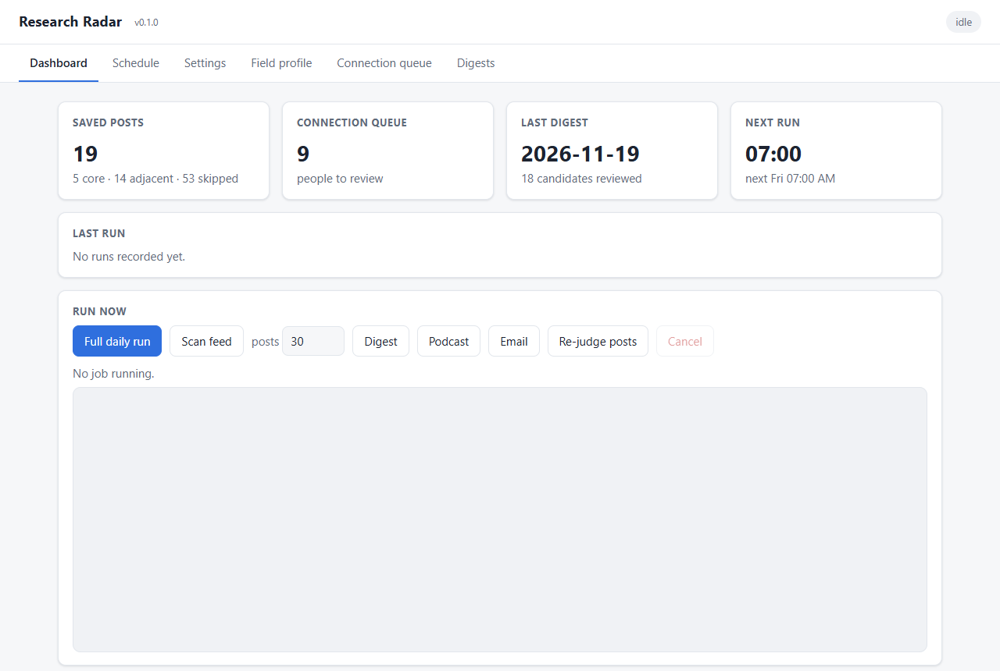
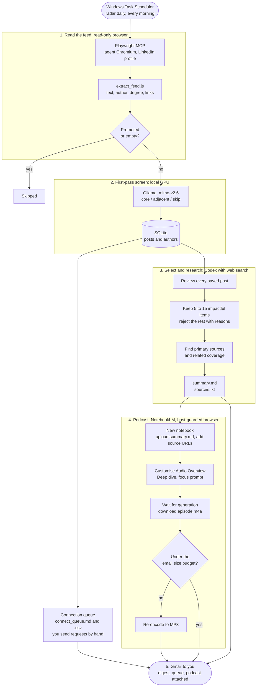

# Research Radar

[](https://github.com/AbrarFaiyad/research-radar/actions/workflows/ci.yml)


Keeping up with new research takes time, and a LinkedIn feed mixes real results with announcements, ads, and personal news. Research Radar reads the feed for you each morning, keeps the work that matters to your field, finds the primary sources, and delivers a written digest and a two-host podcast to your inbox. It also lists the researchers behind that work, so you can connect with them and make your feed better over time.

The repository ships configured for computational materials science. To use it for another field, edit one profile file and one line of settings.

Jump to: [Architecture](#architecture) · [Control panel](#control-panel) · [Installation](#installation) · [Usage](#usage) · [Engineering](#engineering)



## What it does

- Scans the LinkedIn feed and classifies posts against a field profile.
- Exports a queue of authors to consider connecting with. The owner sends each request by hand.
- Sends every saved post to Codex, which keeps the 5 to 15 items with real impact, finds their primary sources and related coverage, and writes the digest.
- Turns the digest into a NotebookLM Audio Overview, a two-host podcast.
- Emails the digest, queue, and podcast to the owner each day.
- Gives you a local control panel to run any step, change settings and the schedule, and work through the queue and past digests.
- Checks its own setup with `radar doctor` and records every daily run, stage by stage.

## Architecture

One daily run, top to bottom:



MCP is the Model Context Protocol, which connects the Python orchestrator to the browser server. The local large language model (LLM) is a permissive first-pass screen. Codex makes the final selection.

| Component | File | Role |
|---|---|---|
| Browser | `src/radar/browser/mcp_client.py` | Starts Playwright MCP and restricts tool calls |
| Extractor | `src/radar/browser/extract_feed.js` | Reads visible feed cards |
| Scanner | `src/radar/scanner.py` | Scrolls, deduplicates and processes posts |
| Classification | `src/radar/classify.py` | Filters and classifies posts |
| Storage and queue | `src/radar/db.py`, `src/radar/queue.py` | Stores records and exports authors |
| Digest | `src/radar/digest.py`, `prompts/codex_digest.md` | Sends candidates to Codex and renders its result |
| Podcast | `src/radar/notebooklm.py` | Builds a notebook and downloads the Audio Overview |
| Email | `src/radar/mailer.py` | Sends the daily email through Gmail SMTP |
| Pipeline | `src/radar/pipeline.py` | Runs stages in isolation, holds the run lock, writes run records |
| Health checks | `src/radar/doctor.py` | Checks every prerequisite and prints the fix for each gap |
| Settings | `src/radar/settings.py` | Typed, validated schema over `config/config.toml` |
| Control panel | `src/radar/ui/` | FastAPI app and single-page interface behind `radar ui` |
| Command line | `src/radar/cli.py` | Entry point for every command |

## Design decisions

The scanner uses deterministic scrolling and extraction through Playwright MCP. The local model judges relevance; it does not direct the browser.

The browser client allows only navigation, evaluation, waiting, snapshots and closing. Tests reject click and form tools. The implemented scanner does not click Connect, like, comment or message. The allowlist alone is not a complete enforcement boundary, because `browser_evaluate` runs JavaScript. The scripts passed to it are fixed in the source code, not written by a model. The only page interaction they perform is expanding "… more" on post text.

The default scan stops after 60 posts, 10 minutes or six scroll steps without new cards. It pauses between steps. [LinkedIn User Agreement section 8.2](https://www.linkedin.com/legal/user-agreement) prohibits automated access and scraping. This tool keeps volume low and reads only the owner’s feed. The owner accepts the account risk.

Ollama runs the high-volume first-pass screen locally, and it leans toward keeping borderline posts. Codex reviews every saved post each day, rejects weak ones with a stated reason, and keeps 5 to 15. If fewer posts meet the bar, Codex keeps fewer instead of padding the list.

NotebookLM has no consumer API, so the agent drives it in a second browser profile. That client may click and type, but only behind a host guard: every interactive call first checks that the page is on `notebook.google.com` or `notebooklm.google.com` and refuses otherwise. A file upload is allowed only straight after a host-checked click. Automating NotebookLM is outside Google's intended use, the same kind of risk as the LinkedIn scan.

The repository ignores `data/`, which contains feed records and the browser profile. Tests use synthetic fixtures. Selected post text and author information are included in the task sent to Codex for research.

## Control panel

```powershell
radar ui
```

This opens a local web page at `http://127.0.0.1:8765`. Only your own computer can reach it.

| Tab | What you can do |
|---|---|
| Dashboard | See saved posts, queue size, the last digest, the next scheduled run, and the last run's stages. Start a full run or any single step, watch its log live, and cancel it. Check setup health and launch the LinkedIn and NotebookLM logins. |
| Schedule | Change the daily run time or switch it off. |
| Settings | Edit every setting in a validated form: scan limits and pacing, local model, Codex selection limits, podcast length, email. Bad values are rejected with a message and the file is left untouched. Comments in `config/config.toml` are kept. |
| Field profile | Edit what counts as relevant, then re-judge stored posts in one click. |
| Connection queue | Open each profile, then mark it Sent, Skip, or back to Todo. |
| Digests | Read past digests, play their podcasts, and open their NotebookLM notebooks. |

<p>


</p>

The panel has no login, so it defends itself in three ways. The server binds to the loopback address only. Every request must name a loopback host, which stops DNS-rebinding pages. Every change must carry a token that is created at launch and embedded in the page, which stops other websites from posting to it. Digest text comes from Codex reading arbitrary web pages, so the panel escapes any HTML in it before display.

## Installation

### Requirements

- Windows 11
- An NVIDIA GPU with at least 8 GB of video memory (VRAM) recommended for the local model. A CPU also works, but is slower.
- About 15 GB of free disk space
- A LinkedIn account
- A Google account for NotebookLM and Gmail
- An OpenAI account for the Codex command-line interface (CLI)

### 1. Install the tools

Open PowerShell and install Git, Python, uv, Node.js, and Ollama:

```powershell
winget install --id Git.Git -e
```

```powershell
winget install --id Python.Python.3.12 -e
```

```powershell
winget install --id astral-sh.uv -e
```

```powershell
winget install --id OpenJS.NodeJS.LTS -e
```

```powershell
winget install --id Ollama.Ollama -e
```

Open a new PowerShell window so Windows can find the installed tools. Install Codex CLI and sign in:

```powershell
npm install -g @openai/codex
```

```powershell
codex login
```

### 2. Get the code

Clone the repository and enter its folder:

```powershell
git clone https://github.com/AbrarFaiyad/research-radar.git
```

```powershell
cd research-radar
```

Run the remaining commands from the `research-radar` folder.

### 3. Create the Python environment

A virtual environment keeps the project's Python packages together.

```powershell
uv venv -p 3.12 .venv
```

```powershell
uv pip install -p .venv -e ".[dev]"
```

```powershell
.\.venv\Scripts\Activate.ps1
```

If PowerShell blocks activation, run the following once, then retry activation:

```powershell
Set-ExecutionPolicy -Scope CurrentUser RemoteSigned
```

Alternatively, call `.\.venv\Scripts\radar.exe` directly in place of `radar`.

### 4. Install the agent browser and the local model

Install Chromium, the browser used by the agent:

```powershell
npx -y playwright@1.65.0-alpha-2026-10-30 install chromium
```

Download the local model. The download is about 6.6 GB.

```powershell
ollama pull mimo-v2.6
```

### 5. Configure

Copy the example configuration:

```powershell
Copy-Item config/config.example.toml config/config.toml
```

Edit `config/config.toml`. Under `[email]`, set `enabled = true` and set `to` to your email address. If a different Gmail account will send the email, set `sender` to that address. Optionally, adjust the `[scan]` limits and the `[notebooklm]` podcast `length`.

Edit `config/field_profile.md` to describe your field and the topics you want to follow. Git ignores `config/config.toml`, so it will not be included in commits.

### 6. Sign in once

Sign in to LinkedIn in the browser window that opens:

```powershell
radar login
```

Sign in to Google for NotebookLM in the next browser window:

```powershell
radar notebooklm-login
```

You enter these passwords in the browser; the agent does not need them.

For email, enable 2-Step Verification on the sending Google account and create a [Gmail App Password](https://myaccount.google.com/apppasswords). An App Password is a separate password for an app. Run the command below and paste it at the hidden prompt. The password is stored in Windows Credential Manager.

```powershell
radar email-setup
```

### 7. Test it

Check that every prerequisite is in place. Each failed check prints the command that fixes it.

```powershell
radar doctor
```

Start Ollama, then run the offline demo. It uses synthetic posts and replaces any existing `data/demo/` folder.

```powershell
radar demo
```

Run the tests:

```powershell
.\.venv\Scripts\python -m pytest
```

Scan up to 15 LinkedIn posts, create a digest, and send the email:

```powershell
radar scan --max-posts 15
```

```powershell
radar digest
```

```powershell
radar email
```

### 8. Run it every day

Register a daily run for 07:00:

```powershell
powershell -ExecutionPolicy Bypass -File scripts\install_schedule.ps1 -Time 07:00
```

The task runs while you are logged in. Logs are saved in `data\logs\`. To remove the task:

```powershell
Unregister-ScheduledTask -TaskName ResearchRadarDaily -Confirm:$false
```

### Troubleshooting

- **“LinkedIn feed not visible (not logged in?)”**: Run `radar login` again.
- **“No SMTP password stored”**: Run `radar email-setup`.
- **“Ollama model ... not reachable”**: Start Ollama and run `ollama pull mimo-v2.6`.
- **Podcast failed after a NotebookLM page change**: The email still sends. Retry with `radar podcast`. The page selectors are in `src/radar/notebooklm.py`.
- **Git reports “detected dubious ownership” in a cloud-synced folder**: Run `git config --global --add safe.directory <path>`, replacing `<path>` with the repository's full path.

## Usage

Every command below is also a button in the [control panel](#control-panel).

```powershell
radar doctor
```

Check Ollama, the model, Codex, the agent browser, both logins, the email password, and the schedule.

```powershell
radar demo
```

The demo classifies synthetic posts and writes a queue under `data/demo/`. It uses Ollama and replaces any existing `data/demo/` directory.

```powershell
radar scan
```

Scan the feed, classify new posts and refresh the queue.

```powershell
radar reclassify
```

Re-judge every stored post with the current field profile, for example after editing `config/field_profile.md`. Posts that become relevant get their links resolved.

```powershell
radar queue
```

Export the current connection queue.

```powershell
radar queue mark <profile_url> sent
```

Replace `<profile_url>` with the author’s URL after sending a request. `skip`, `todo` and `connected` are also supported statuses.

```powershell
radar digest
```

Send every undigested saved post to Codex, which selects, sources, and summarizes the strongest 5 to 15, then generate the NotebookLM podcast. Codex judges every candidate, so each post is reviewed once. Saved posts older than three days (`backlog_days`) are dropped. A second run on the same day writes to a new folder, such as `2026-11-19-2`.

```powershell
radar podcast
```

Generate the NotebookLM podcast again for the latest digest, for example after a NotebookLM failure. Pass a folder name to pick another digest.

```powershell
radar daily
```

Run a scan followed by a digest.

```powershell
radar status
```

Show database counts, queue size, the latest digest, and the last run's stages.

To schedule the daily cycle for 07:00:

```powershell
powershell -ExecutionPolicy Bypass -File scripts/install_schedule.ps1 -Time 07:00
```

The task runs when the user is logged in and starts after a missed run when available. Remove the default task with:

```powershell
Unregister-ScheduledTask -TaskName ResearchRadarDaily -Confirm:$false
```

## Engineering

- **Stage isolation.** `radar daily` runs scan, digest, and email as separate stages. A failed stage is recorded with its error, and the later stages still run, so a logged-out LinkedIn session still lets the backlog digest and the email go out. The command exits with code 1 when any stage fails, which Task Scheduler records.
- **Run records.** Each daily run writes `data/runs/<timestamp>.json` with every stage's outcome, duration, counts, and error. The dashboard and `radar status` read them.
- **One run at a time.** A lock file in `data/` stops the scheduled task, the panel, and the command line from running jobs at once. A lock older than three hours counts as stale.
- **Read-only by construction.** The LinkedIn browser client cannot reach any click or type tool. The NotebookLM client can, but only while the page is on NotebookLM's own hosts. Tests cover both.
- **Validated settings.** Settings have a typed schema with ranges and cross-field rules, such as minimum items not exceeding maximum items. Saves are atomic and keep the file's comments.
- **Privacy.** `data/` and `config/config.toml` are gitignored. Tests use synthetic posts. `radar doctor` masks email addresses and home-folder paths in its output.
- **Quality gates.** GitHub Actions runs Ruff lint, a format check, and the full test suite on Ubuntu and Windows for every push and pull request. Pre-commit runs the same checks locally.

## Example output

The files in `docs/example/` come from an early version that ran on the synthetic fixture posts. Their links point to `example.org`, so Codex could not find primary sources and reported that plainly with low confidence.

- [Digest summary](docs/example/digest-summary.md)
- [Connection queue](docs/example/connect-queue.md)

## Outputs

Default paths are relative to the repository root:

- `data/radar.db`: SQLite database of posts, authors and digests.
- `data/queue/connect_queue.md` and `connect_queue.csv`: connection queue.
- `data/digests/YYYY-MM-DD/summary.md`: researched briefing.
- `data/digests/YYYY-MM-DD/sources.txt`: primary and supporting URLs given to NotebookLM.
- `data/digests/YYYY-MM-DD/notebook_url.txt`: link to the day's NotebookLM notebook.
- `data/digests/YYYY-MM-DD/episode.m4a`: the NotebookLM Audio Overview, when generation succeeds.
- `data/digests/YYYY-MM-DD/codex_task.md` and `codex_result.json`: research prompt and structured result.
- `data/runs/<timestamp>.json`: stage-by-stage record of each daily run.
- `data/logs/`: scheduled daily-run logs.

## Podcast

The podcast is a NotebookLM Audio Overview in the Deep dive format. For each digest the agent:

1. creates a new notebook;
2. uploads `summary.md` and adds Codex's source URLs as website sources (paywalled pages fail individually and are skipped);
3. opens "Customise Audio Overview", picks Deep dive and the configured length, and writes focus instructions from Codex's `podcast_focus`;
4. waits for generation, usually 5 to 15 minutes, and downloads the `.m4a` file.

The notebook stays in your NotebookLM account, so you can also listen or ask questions there. Set `length` under `[notebooklm]` to `shorter`, `default`, or `longer`. NotebookLM's interface changes over time; the selectors live in `src/radar/notebooklm.py`.

## Daily email

`radar daily` ends by emailing the day's digest to you when `[email] enabled = true`. The message body holds the digest and the connection queue. The attachments are the podcast (`episode.m4a`), `summary.md`, and `connect_queue.csv`, and the body links to the day's NotebookLM notebook. Gmail limits a message to 25 MB, and a default-length episode is about 17 MB. A file that would push the message past the limit is listed with its local path instead of attached; the notebook link still works.

Email goes out through Gmail SMTP with an App Password. An App Password is a 16-character password that Google issues for one app; it requires 2-Step Verification on the account.

1. Create one at <https://myaccount.google.com/apppasswords>.
2. Set `to` (and `sender`, if a different Gmail account sends) under `[email]` in `config/config.toml`.
3. Store the password in Windows Credential Manager. The prompt hides your input, and the password never touches the repository or config files.

```powershell
radar email-setup
```

4. Send a test with the latest digest:

```powershell
radar email
```

To revoke access, delete the App Password in your Google account.

## Customizing the field

Edit `config/field_profile.md` to define core topics, adjacent topics and material to skip, and set `reader` under `[profile]` in `config/config.toml` to describe who the digest is for. Both are editable in the control panel. The local screen and Codex both use this profile. Run `radar reclassify` afterward to apply the change to stored posts.

Concrete examples in the profile help the 9B model more than abstract categories. On the first live scan, adding one example line moved an agentic-coding preprint from skip to adjacent, and a biology rule stopped a protein-model press release from being marked core. Classification runs at temperature 0, so the same post gets the same verdict. Setting `think = true` under `[llm]` makes the model reason first; in tests this was about three times slower and not more accurate overall.

## Tests

```powershell
.\.venv\Scripts\python -m pytest
```

Tests cover classification, scanning, deduplication, link handling, queue exports, browser tool restrictions, digest generation, NotebookLM page parsing and host guard, email composition and audio re-encoding, stage isolation and the run lock, health checks, settings validation, and the control panel API and its security checks. They use synthetic data and fakes, so they need no network, accounts, or GPU.

## Limitations

- LinkedIn changes its page structure. Feed selectors live in `src/radar/browser/extract_feed.js`.
- The 9B local model misjudges some posts.
- Codex research quality depends on finding and interpreting the primary source.
- NotebookLM interface changes can break the podcast step; the written digest and email still go out.
- Automated feed access carries the LinkedIn User Agreement risk described above.

## License

MIT.