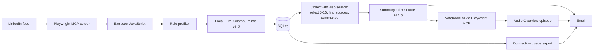

# Research Radar

Keeping up with AI-for-materials research takes time, and a LinkedIn feed mixes research with posts that do not report scientific results. Research Radar gives a computational materials scientist a daily researched briefing and a list of researchers to connect with by hand, with the goal of making the feed more relevant.

## What it does

- Scans the LinkedIn feed and classifies posts against a field profile.
- Exports a queue of authors to consider connecting with. The owner sends each request by hand.
- Sends every saved post to Codex, which keeps the 5 to 15 items with real impact, finds their primary sources and related coverage, and writes the digest.
- Turns the digest into a NotebookLM Audio Overview, a two-host podcast.
- Emails the digest, queue, and podcast to the owner each day.

## Architecture



MCP is the Model Context Protocol, which connects the Python orchestrator to the browser server. The local large language model (LLM) is a permissive first-pass screen. Codex makes the final selection.

| Component | File | Role |
|---|---|---|
| Browser | `src/radar/browser/mcp_client.py` | Starts Playwright MCP and restricts tool calls |
| Extractor | `src/radar/browser/extract_feed.js` | Reads visible feed cards |
| Scanner | `src/radar/scanner.py` | Scrolls, deduplicates and processes posts |
| Classification | `src/radar/classify.py` | Filters and classifies posts |
| Storage and queue | `src/radar/db.py`, `src/radar/queue.py` | Stores records and exports authors |
| Digest | `src/radar/digest.py`, `prompts/codex_digest.md` | Sends candidates to Codex and renders its result |
| Podcast | `src/radar/notebooklm.py` | Builds a notebook and downloads the Audio Overview |
| Email | `src/radar/mailer.py` | Sends the daily email through Gmail SMTP |
| Command line | `src/radar/cli.py` | Runs the pipeline and reports status |

## Design decisions

The scanner uses deterministic scrolling and extraction through Playwright MCP. The local model judges relevance; it does not direct the browser.

The browser client allows only navigation, evaluation, waiting, snapshots and closing. Tests reject click and form tools. The implemented scanner does not click Connect, like, comment or message. The allowlist alone is not a complete enforcement boundary, because `browser_evaluate` runs JavaScript. The scripts passed to it are fixed in the source code, not written by a model. The only page interaction they perform is expanding "… more" on post text.

The default scan stops after 60 posts, 10 minutes or six scroll steps without new cards. It pauses between steps. [LinkedIn User Agreement section 8.2](https://www.linkedin.com/legal/user-agreement) prohibits automated access and scraping. This tool keeps volume low and reads only the owner’s feed. The owner accepts the account risk.

Ollama runs the high-volume first-pass screen locally, and it leans toward keeping borderline posts. Codex reviews every saved post each day, rejects weak ones with a stated reason, and keeps 5 to 15. If fewer posts meet the bar, Codex keeps fewer instead of padding the list.

NotebookLM has no consumer API, so the agent drives it in a second browser profile. That client may click and type, but only behind a host guard: every interactive call first checks that the page is on `notebook.google.com` or `notebooklm.google.com` and refuses otherwise. A file upload is allowed only straight after a host-checked click. Automating NotebookLM is outside Google's intended use, the same kind of risk as the LinkedIn scan.

The repository ignores `data/`, which contains feed records and the browser profile. Tests use synthetic fixtures. Selected post text and author information are included in the task sent to Codex for research.

## Requirements

- Windows 11
- Python 3.12 or later and `uv`
- Node.js, for `npx`
- Ollama with `mimo-v2.6` (6.6 GB; fits a 16 GB GPU)
- Codex CLI, logged in
- Playwright Chromium

## Setup

Run these commands from the repository root in PowerShell.

```powershell
uv venv -p 3.12 .venv
```

```powershell
uv pip install -p .venv -e ".[dev]"
```

```powershell
npx -y playwright@1.65.0-alpha-2026-10-30 install chromium
```

```powershell
ollama pull mimo-v2.6
```

```powershell
Copy-Item config/config.example.toml config/config.toml
```

```powershell
.\.venv\Scripts\Activate.ps1
```

```powershell
radar login
```

Log in to LinkedIn in the browser window.

```powershell
radar notebooklm-login
```

Sign in to Google in the browser window. Start Ollama before running a scan or demo.

## Usage

```powershell
radar demo
```

The demo classifies synthetic posts and writes a queue under `data/demo/`. It uses Ollama and replaces any existing `data/demo/` directory.

```powershell
radar scan
```

Scan the feed, classify new posts and refresh the queue.

```powershell
radar reclassify
```

Re-judge every stored post with the current field profile, for example after editing `config/field_profile.md`. Posts that become relevant get their links resolved.

```powershell
radar queue
```

Export the current connection queue.

```powershell
radar queue mark <profile_url> sent
```

Replace `<profile_url>` with the author’s URL after sending a request. `skip`, `todo` and `connected` are also supported statuses.

```powershell
radar digest
```

Send every undigested saved post to Codex, which selects, sources, and summarizes the strongest 5 to 15, then generate the NotebookLM podcast. Codex judges every candidate, so each post is reviewed once. Saved posts older than three days (`backlog_days`) are dropped. A second run on the same day writes to a new folder, such as `2026-11-19-2`.

```powershell
radar podcast
```

Generate the NotebookLM podcast again for the latest digest, for example after a NotebookLM failure. Pass a folder name to pick another digest.

```powershell
radar daily
```

Run a scan followed by a digest.

```powershell
radar status
```

Show database counts, queue size and the latest digest.

To schedule the daily cycle for 08:30:

```powershell
powershell -ExecutionPolicy Bypass -File scripts/install_schedule.ps1 -Time 08:30
```

The task runs when the user is logged in and starts after a missed run when available. Remove the default task with:

```powershell
Unregister-ScheduledTask -TaskName ResearchRadarDaily -Confirm:$false
```

## Example output

The files in `docs/example/` come from an early version that ran on the synthetic fixture posts. Their links point to `example.org`, so Codex could not find primary sources and reported that plainly with low confidence.

- [Digest summary](docs/example/digest-summary.md)
- [Connection queue](docs/example/connect-queue.md)

## Outputs

Default paths are relative to the repository root:

- `data/radar.db`: SQLite database of posts, authors and digests.
- `data/queue/connect_queue.md` and `connect_queue.csv`: connection queue.
- `data/digests/YYYY-MM-DD/summary.md`: researched briefing.
- `data/digests/YYYY-MM-DD/sources.txt`: primary and supporting URLs given to NotebookLM.
- `data/digests/YYYY-MM-DD/notebook_url.txt`: link to the day's NotebookLM notebook.
- `data/digests/YYYY-MM-DD/episode.m4a`: the NotebookLM Audio Overview, when generation succeeds.
- `data/digests/YYYY-MM-DD/codex_task.md` and `codex_result.json`: research prompt and structured result.
- `data/logs/`: scheduled daily-run logs.

## Podcast

The podcast is a NotebookLM Audio Overview in the Deep dive format. For each digest the agent:

1. creates a new notebook;
2. uploads `summary.md` and adds Codex's source URLs as website sources (paywalled pages fail individually and are skipped);
3. opens "Customise Audio Overview", picks Deep dive and the configured length, and writes focus instructions from Codex's `podcast_focus`;
4. waits for generation, usually 5 to 15 minutes, and downloads the `.m4a` file.

The notebook stays in your NotebookLM account, so you can also listen or ask questions there. Set `length` under `[notebooklm]` to `shorter`, `default`, or `longer`. NotebookLM's interface changes over time; the selectors live in `src/radar/notebooklm.py`.

## Daily email

`radar daily` ends by emailing the day's digest to you when `[email] enabled = true`. The message body holds the digest and the connection queue. The attachments are the podcast (`episode.m4a`), `summary.md`, and `connect_queue.csv`, and the body links to the day's NotebookLM notebook. Gmail limits a message to 25 MB, and a default-length episode is about 17 MB. A file that would push the message past the limit is listed with its local path instead of attached; the notebook link still works.

Email goes out through Gmail SMTP with an App Password. An App Password is a 16-character password that Google issues for one app; it requires 2-Step Verification on the account.

1. Create one at <https://myaccount.google.com/apppasswords>.
2. Set `to` (and `sender`, if a different Gmail account sends) under `[email]` in `config/config.toml`.
3. Store the password in Windows Credential Manager. The prompt hides your input, and the password never touches the repository or config files.

```powershell
radar email-setup
```

4. Send a test with the latest digest:

```powershell
radar email
```

To revoke access, delete the App Password in your Google account.

## Customizing the field

Edit `config/field_profile.md` to define core topics, adjacent topics and material to skip. The local screen and Codex both use this profile. Run `radar reclassify` afterward to apply the change to stored posts.

Concrete examples in the profile help the 9B model more than abstract categories. On the first live scan, adding one example line moved an agentic-coding preprint from skip to adjacent, and a biology rule stopped a protein-model press release from being marked core. Classification runs at temperature 0, so the same post gets the same verdict. Setting `think = true` under `[llm]` makes the model reason first; in tests this was about three times slower and not more accurate overall.

## Tests

```powershell
.\.venv\Scripts\python -m pytest
```

Tests cover classification, scanning, deduplication, link handling, queue exports, browser tool restrictions, digest generation, NotebookLM page parsing and host guard, and email composition, using synthetic data and fakes.

## Limitations

- LinkedIn changes its page structure. Feed selectors live in `src/radar/browser/extract_feed.js`.
- The 9B local model misjudges some posts.
- Codex research quality depends on finding and interpreting the primary source.
- NotebookLM interface changes can break the podcast step; the written digest and email still go out.
- Automated feed access carries the LinkedIn User Agreement risk described above.

## License

MIT.